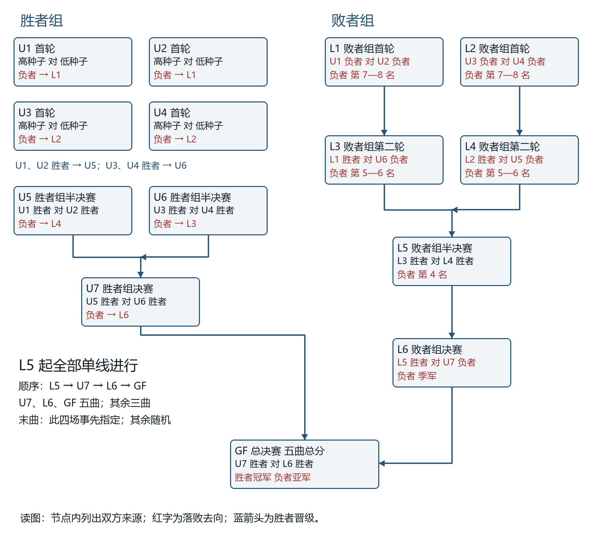

本赛事分为三个阶段：线上预选、线下最后机会资格赛（LCQ）和线下八强双败正赛。

> **核心要点速览**
> - 预选前 7 名直接进入正赛，第 8—15 名参加 LCQ，LCQ 最终只产生 1 个正赛名额。
> - 预选必须把 3 首指定曲目录在同一段连续视频中，并提交视频和在线成绩登记。
> - 所有比赛都必须打完规定曲目，按整场结算分数总和决定排名或胜负。
> - 线下比赛暂定于 2027 年 1 月 1 日举行。场地、签到时间、入校和观赛安排确定后另行公告。

以下规则中，已经确定的内容会直接写明；标注“待议”或“另行公告”的事项，以后续统一公告为准。

## 一、赛事概况

本赛事由三校 Arcaea 玩家共同策划，以交流技艺、公平竞技为宗旨，采用“线上预选赛＋线下最后机会资格赛＋线下八强双败正赛”的形式。

线下比赛拟于 2027 年 1 月 1 日举行。具体场地、签到及开赛时间、入校与观赛安排待议，确定后统一公告。

本届设置一个竞技组，不另设按实力划分的竞技分组。娱乐活动视现场条件另行安排，不影响资格赛与正赛进行。

## 二、报名与参赛资格

> **报名前请确认**：你需要能用自己的 Arcaea 账号游玩全部预选课题，并如实申报曲包和谱面解锁情况。买了曲包不等于已解锁其中所有谱面，曲包与谱面会分别核验。

1. 参赛者须通过指定渠道报名，填写参赛昵称、联系方式、Arcaea 玩家 ID、学校信息及曲包拥有情况。每人只能报名一次。
2. 本赛事仅面向联合举办赛事的三校玩家，不对其他学校或校外玩家开放。报名入口和成绩登记文档待议，最迟于 2026 年 11 月 15 日前确定并公布。
3. LCQ 分组轮从 8 名选手的共同曲池中选曲；LCQ 决胜轮和正赛则按每场对阵双方的共同曲池选曲。
4. 预选结束后，工作人员会向前 15 名发放曲库调查表，核对曲包、附加包、单曲以及 BYD／ETR／INS 谱面的解锁情况，并记录核验日期。比赛前一周锁定资料。调查范围包括 Diverse System 曲包和其他新增曲目。
5. 参赛者原则上应自备熟悉的设备和耳机。如果设备、账号或曲目解锁有困难，请在比赛前联系工作人员协调。
6. 禁止代打、冒名参赛、篡改成绩、使用自动游玩工具，以及其他影响公平性的行为。

## 三、赛程安排

所有时间均为北京时间。

| 阶段 | 时间 | 内容 |
| --- | --- | --- |
| 规则与课题公布 | 2026 年 11 月上旬 | 发布章程，并陆续公布 3 首预选课题 |
| 预选赛 | 2026 年 11 月 15 日 00:00—12 月 15 日 23:59 | 在线完成挑战，提交成绩和视频 |
| 成绩审核与名单公示 | 预选结束后 | 核验成绩，公布直通正赛、LCQ 和候补名单 |
| 线下比赛 | 2027 年 1 月 1 日 | 进行 LCQ、八强双败正赛、总决赛和颁奖 |

> **预选截止提醒**：只有在预选开放期间完成并提交的成绩有效。预选开始前，3 首课题必须全部公布。

如果场地或其他客观条件导致赛程调整，筹备组会统一公告，并给选手合理的准备时间。

## 四、线上预选赛

### 4.1 预选课题

以下三张谱面必须在同一组挑战中全部完成，游玩顺序由选手自行选择。表内编号仅用于列举，不规定顺序：

| 编号 | 歌曲 | 指定难度 |
| --- | --- | --- |
| 1 | Judgement | FTR 10 |
| 2 | Infinite Strife, | BYD 10+ |
| 3 | chronologia | ETR 10+ |

歌曲名称及难度以最终课题公告为准，其他难度的成绩无效。

### 4.2 游玩要求

> **有效预选挑战原则**：一次有效挑战 = 一段连续无剪辑视频 + 连续打完 3 首指定课题。

1. 三首课题必须组成一组完整挑战，并在同一段连续视频中完成。
2. 曲间可以查看结算、切换歌曲和进行必要设置，但不能插入其他歌曲、试打、单独重开某首歌或中断录制。
3. 想要重试时，必须结束当前挑战，从头重新录制一组完整的三曲挑战。新一组可以重新安排歌曲顺序。
4. 预选期间可以不限次数挑战和提交，最终取审核通过的最高整组总分。
5. 不得把不同挑战中的单曲最高分拼成一组成绩。

### 4.3 视频与提交要求

手元录像和屏幕录制均可。视频分辨率至少为 720p，帧率至少为 30fps。录制时按以下顺序进行：先展示实时时间，再连续完成 3 首课题并逐首展示结算，最后再次展示实时时间，然后结束录制。

- **手元录像**：画面须清楚拍到双手、设备屏幕和完整游玩过程，结算成绩也要能辨认。
- **屏幕录制**：须开启游戏内触点显示，并完整录下操作过程和结算页面。
- **时间核验**：视频开头和结尾都须打开 [https://www.beijing-time.org](https://www.beijing-time.org)，清楚展示日期、时分秒及秒数跳动。屏幕录制也须按此要求操作。时间页面、三曲游玩和结算必须在同一段连续录制中；不能用截图、静止画面或系统时钟代替。若网页无法使用，请先联系工作人员，获准替代方式后再开始挑战。
- **视频完整性**：视频须为连续原始记录，不能剪辑、变速、拼接或遮挡关键内容。
- **上传视频**：将视频上传至 B 站，并添加标签 `#合肥第一音游祭`。标题格式为 `【合肥第一音游祭】[id] [sumscore]pts`。把 `[id]` 替换为报名时使用的参赛 ID，把 `[sumscore]` 替换为本组实际三曲总分，并删除方括号。例如：`【合肥第一音游祭】海棠 29987654pts`。
- **登记成绩**：在届时发布的在线文档中填写参赛 ID、Arcaea 玩家 ID、各首课题分数、三曲总分和 BV 号。在线登记是正式提交的一部分；只上传视频不算完成成绩提交。视频须能正常访问，并保留原始录像以供复核。
- **更新成绩**：如更新成绩，请填写新 BV 号和对应成绩，同时保留旧记录。最终采用截止前提交且审核通过的最高完整组三曲总分。视频上传和在线登记都须在截止前完成；如遇平台审核异常，也须在截止前联系工作人员。

> **录制条件不足**：如果设备性能或录制条件确实无法满足要求，请在提交截止前联系工作人员安排人工核验。未经允许，不得自行免除凭证要求。

### 4.4 计分与晋级

1. 预选按同一组挑战中 3 首歌曲的结算分数相加排名，不做额外换算。
2. 三曲总分相同时，取得该成绩的视频录制时间较早者排名靠前。以视频开头展示的北京时间为准。同一选手有多份同分且审核通过的完整视频时，取录制时间最早的一份。
3. 同分时只比较视频录制时间，不比较上传时间、在线文档填写时间、歌曲游玩顺序或单首歌曲分数。
4. 预选第 1—7 名直接晋级八强正赛；第 8—15 名参加 LCQ。
5. 其余选手按预选排名列为候补。若有效参赛人数不足以组成上述赛制，筹备组会提前公布简化方案。

## 五、最后机会资格赛 LCQ

### 5.1 分组

LCQ 拟于线下比赛当天、八强正赛之前举行。

| 组别 | 预选赛排名 |
| --- | --- |
| A 组 | 第 8、11、12、15 名 |
| B 组 | 第 9、10、13、14 名 |

### 5.2 分组轮：八进二

> **分组轮晋级关系**：8 名 LCQ 选手分为 A、B 两组（每组 4 人）。每组第 1 名进入决胜轮；决胜轮胜者将成为正赛第 8 号种子。

赛前统计 8 位 LCQ 选手的曲包拥有情况，取 8 人共有曲包中所有定数 10.7—11.5、且 8 人都已解锁的合规谱面组成曲池。Pentiment[BYD 11] 和 ⊥⊬ [FTR 10+] 不得使用。

主办方现场从曲池中随机抽取 2 首不同课题。A、B 两组使用相同的歌曲和难度，不设置选手禁曲或自选曲。

每人完整游玩 2 首课题，按两曲结算分数总和进行组内排名。每组第 1 名进入决胜轮。

如果现场具备四人同时游玩和核验的条件，两组可以并行进行；否则依次进行。无论是否并行，各组选手的正式游玩次数必须一致。

### 5.3 决胜轮：二进一

两位小组第 1 名进行三曲总分制对赛。曲池取双方曲包交集内所有定数 10.7—11.5、且双方都已解锁的合规谱面。Pentiment[BYD 11] 和 ⊥⊬ [FTR 10+] 不得使用。

禁选流程与正赛 U1—U6、L1—L4 相同：双方各禁 1 张、各选 1 张，最后 1 张由裁判从当场合法曲池中随机抽取。禁曲重合、选曲重合和跨场选曲限制按第 6.4 节执行。

三曲全部完成后，总分较高者获得正赛资格，成为第 8 号种子，与预选前 7 名组成正赛八强。同分时按第 5.4 节处理。

### 5.4 同分与游玩要求

LCQ 分组轮总分相同时，预选排名更高者排名靠前；决胜轮总分相同时，预选排名更高者获胜。两种情况都不另行加赛。

每首正式课题只进行 1 次正式游玩，正常失误不能重开。

## 六、八强双败正赛

### 6.1 初始对阵与晋级路径

> **双败淘汰规则**：正赛从八强首轮开始采用双败制。在胜者组输掉 1 场进入败者组；在败者组再输 1 场即遭淘汰。

初始抽签分为两个种子池：第 1—4 号为高种子，第 5—8 号为低种子。公开随机抽取 4 组高、低种子对阵，再随机放入 U1—U4。抽签结束后，整张赛程固定，后续不再按种子重新配对。抽签时间和具体安排另行公告。

所有对阵都是两人对赛。U 代表胜者组，L 代表败者组；W 表示该场胜者，D 表示该场负者。各场比赛的去向如下：

| 场次 | 对阵来源 | 胜者与负者去向 |
| --- | --- | --- |
| U1、U2 | 抽签后的首轮前两场 | 胜者进 U5；负者进 L1 |
| U3、U4 | 抽签后的首轮后两场 | 胜者进 U6；负者进 L2 |
| U5 | W(U1) 对 W(U2) | 胜者进 U7；负者进 L4 |
| U6 | W(U3) 对 W(U4) | 胜者进 U7；负者进 L3 |
| L1 | D(U1) 对 D(U2) | 胜者进 L3；负者并列第 7—8 名 |
| L2 | D(U3) 对 D(U4) | 胜者进 L4；负者并列第 7—8 名 |
| L3 | W(L1) 对 D(U6) | 胜者进 L5；负者并列第 5—6 名 |
| L4 | W(L2) 对 D(U5) | 胜者进 L5；负者并列第 5—6 名 |
| L5 败者组半决赛 | W(L3) 对 W(L4) | 胜者进 L6；负者第 4 名，此场为四进三 |
| U7 胜者组决赛 | W(U5) 对 W(U6) | 胜者进 GF；负者进 L6 |
| L6 败者组决赛 | W(L5) 对 D(U7) | 胜者进 GF；负者季军，此场为三进二 |
| GF 总决赛 | W(U7) 对 W(L6) | 胜者冠军；负者亚军 |

L6 败者组决赛决定季军及另一个总决赛名额。不再额外安排三四名争夺赛。败者组 L3、L4 采用交叉接入，避免胜者组半决赛落败后立即再次遇到首轮对手。

### 八强双败完整流程图

<figure class="charter-figure">
  
  <figcaption>蓝线为胜者晋级，红字注明落败去向。U1—U4 的参赛者由高低种子抽签确定。各场完整打满曲目，以总分判胜。<a href="/rules/double-elimination.png" target="_blank" rel="noopener">查看大图</a></figcaption>
</figure>

### 6.2 各轮曲数与难度范围

> **注意：BO3 与 BO5 的含义**
> BO3 代表必须打满 3 首歌，BO5 代表必须打满 5 首歌。所有比赛都是“打完所有曲目后比较总分”，不存在“先胜 2 曲或 3 曲直接结束”。

下表中的定数范围包含上下限。所有曲目还必须满足双方共有曲池和禁用规则。

| 场次 | 曲数与选曲构成 | 合法难度范围 |
| --- | --- | --- |
| U1—U6、L1—L4 四强产生前 | 3 曲：双方各选 1 曲＋最后随机 1 曲 | 定数 10.7—11.5，禁用 Pentiment[BYD 11] |
| L5 败者组半决赛 | 3 曲：双方各选 1 曲＋最后事先指定 1 曲 | 定数 10.9—11.9，额外开放 DEINOS PHAINEIN[INS 12] |
| U7 胜者组决赛、L6 败者组决赛 | 5 曲：双方各选 2 曲＋最后事先指定 1 曲 | 定数 10.9—11.9，额外开放 DEINOS PHAINEIN[INS 12] |
| GF 总决赛 | 5 曲：双方各选 2 曲＋最后事先指定 1 曲 | 定数 11.0 及以上，不设定数上限 |

全赛事禁用 ⊥⊬ [FTR 10+]，包括 LCQ 及正赛。Pentiment[BYD 11] 在 LCQ 全程及正赛四强产生前的 U1—U6、L1—L4 禁用；正赛后续轮次按各自合法曲池判断是否可选。

L5、U7、L6、GF 的最后一曲由主办方事先指定；LCQ 决胜轮及其余正赛的最后一曲，由裁判在当场合法曲池中公开随机抽取。

### 6.3 整场计分与同分判定

> **正赛胜负只看整场总分**
> 双方必须打完全部规定曲目，之后把每首歌的游戏结算分数相加。总分高者获胜；不会因为单曲输赢或暂时分差大而提前结束比赛。

1. 双方游玩同一组谱面，每首只进行 1 次正式游玩。正常失误不能重开。
2. 每首计入游戏结算页面显示的整数分数，包括大 PURE 附加分。整场总分直接相加，不按单曲胜负计分，不额外增加小 PURE 惩罚，也不使用历史最高分。
3. 单曲同分时照常记录并继续下一曲；所有规定曲目完成后，总分较高者获胜。
4. 正赛整场总分相同时，预选排名更高者获胜，不另行加赛。LCQ 晋级者以第 8 号种子参加正赛。
5. 每首结算都须保留并由裁判核对。整场结束后，裁判会再次核对各曲明细和总分，再填写晋级记录。

### 6.4 双方共有曲池与常规禁选

> **禁选流程核心速览**
> 1. **算曲池**：先取两人曲包交集和已解锁谱面，剔除禁用曲，得到当场可用曲池。
> 2. **禁选**：双方各自禁曲、选曲（自己选过的歌、对手用来打过你的歌，后续都不能再主动选）。
> 3. **末曲**：最后一曲由主办方事先指定或裁判现场公开抽选。

1. **确定当场曲池**：LCQ 决胜轮和正赛每轮，先取两位选手的曲包交集，再挑出本轮限定定数范围内、且双方都已解锁的合规谱面；扣除全局禁用和本轮禁用后，得到当场可用曲池。其他选手有没有这些曲包不影响本场。附加包和单曲单独核验。
2. **版本与定数依据**：比赛采用届时最新版本，定数以 v7.1 定数表为准。曲库收录截止日期与曲包锁定日期分别确定。同一首歌曲的不同难度分别核验定数和解锁情况。
3. **曲池公示**：对阵确定后、禁选开始前，裁判会向双方展示当场曲池。自选曲、随机曲、指定曲和备用课题都必须出自当场曲池。
4. **曲目锁定**：选手曲包与谱面解锁情况在比赛前一周锁定。锁定前须如实申报核验；锁定后以登记资料为准，不能在赛前临时补买或加解锁来更改曲池。
5. **禁曲数量与规则**：BO3 双方各禁 1 首、各选 1 首；BO5 双方各禁 2 首、各选 2 首。双方可以禁同一首歌，重复禁用只占一个禁曲名额，不补禁。禁曲公示后本场不能再选。
6. **禁选顺序**：除总决赛外，先禁曲再选曲。高种子优先选择“先选还是后选”，双方交替选曲。LCQ 决胜轮由预选排名决定该权利。
7. **选曲重合处理**：双方可以选同一首歌。如果选了同一首，该曲只打一次，缺少的曲目由裁判从当场曲池随机抽取补足。五曲场同一选手的两次选曲不能重复。
8. **跨场选曲限制**：你自己曾经主动选过的歌，后续不能再主动选；对手曾经主动选来对阵你的歌，后续你也不能再主动选。裁判会记录双方的历史自选曲目，并在每场前合并生成当场“不可自选列表”。这一限制从 LCQ 决胜轮开始累计，延续至总决赛。
9. **不受跨场限制的曲目**：裁判随机抽取的曲目、因选曲重合补抽的曲目，以及主办方指定的末曲，都不算选手的自选曲，不会记入上述限制名单。
10. **指定课题**：事先指定末曲的公布时间和衔接流程，会在赛前统一公告。随机补曲不会顶替原有的随机或指定末曲，整场仍须打完规定的 3 首或 5 首。

### 6.5 总决赛先选保护

总决赛双方各禁 2 张、各选 2 张谱面。胜者组冠军享有一次受保护的先选权，流程如下：

1. 胜者组冠军先从合法曲池选定 1 张符合跨场选曲限制的谱面，该谱面锁定，后续不得被禁用。
2. 双方各禁 2 张谱面，双方禁曲可重复，但不得禁用已保护的先选曲；由裁判统一公示。
3. 败者组冠军从禁用后的合法曲池中选定 2 张符合跨场选曲限制的谱面。
4. 胜者组冠军再从禁用后的合法曲池中选定 1 张符合跨场选曲限制、且不同于本人先选曲的谱面。
5. 双方选曲如有重复，由裁判随机补足；加入主办方事先指定的最后一曲，形成完整五曲对赛。

双方完整游玩五曲后按总分判胜。胜者组冠军不额外获得分数或胜曲。

### 6.6 双舞台排程

前期主、副舞台各进行一场比赛，两场并行。完成 L3、L4 后，L5、U7、L6、GF 全部转为单线，副舞台不再安排同时进行的正式对赛。

| 时段 | 主舞台 | 副舞台 |
| --- | --- | --- |
| 1 | U1 | U2 |
| 2 | U3 | U4 |
| 3 | L1 | L2 |
| 4 | U5 | U6 |
| 5 | L3 | L4 |
| 6 | L5 败者组半决赛 四进三 | 停止并行比赛 |
| 7 | U7 胜者组决赛 | 停止并行比赛 |
| 8 | L6 败者组决赛 决出季军 | 停止并行比赛 |
| 9 | GF 总决赛 | 停止并行比赛 |

每一时段须待其依赖场次完成、成绩确认且选手获得规定休息后开始。两个舞台应分别配备裁判和成绩记录人员，统一版本、课题规则及核验标准。不能因为另一舞台提前结束而压缩选手必要休息。

现场安排待议，包括场地、签到与开赛时间、主副舞台设备及人员、调试时长、最低休息时长和迟到宽限。确定后统一公布现场时间表。

## 七、设备与现场秩序

1. 选手须按公告时间完成签到，并配合完成设备、音频、录制或投屏检查。
2. 所有选手享有相同的赛前调试与热身时间，具体时长按现场流程统一执行。
3. 选手可以使用个人习惯的流速、音符偏移等常规设置；是否允许使用影响谱面判定、特殊搭档技能或特殊模式，以赛前公告为准。
4. 现场统一采用最新游戏版本和本章程计分规则，比赛期间不得擅自切换版本或特殊模式。
5. 游玩过程中如遇设备、耳机或现场设施突发故障，请立即举手示意裁判；是否重赛由裁判根据现场情况判定。
6. 正常手滑、按错、紧张或发挥失常，不能作为重赛理由。
7. 现场观众不得遮挡拍摄、触碰选手设备、持续制造干扰，或在游玩中提示打法。

## 八、弃权、递补与申诉

> **申诉时限**
> - 对预选审核、排名或参赛资格有异议：在成绩公示后 48 小时内提出，并附上证据。
> - 对现场成绩或判罚有异议：在下一首曲目开始前提出；赛后发现的作弊证据不受此限。

1. 无法参加后续赛程的选手，请尽早告知工作人员。
2. 正赛名单锁定前，若直通正赛的选手退赛，按预选排名顺位递补，LCQ 资格顺延。
3. 名单锁定后至线下开赛前缺席、或 LCQ 晋级者无法打正赛的，按候补名单顺位替补，不临时安排无资格人员参赛。
4. 八强正赛开始后退赛，或超过到场宽限时间，该场直接判负，对手晋级。首轮弃权是否保留败者组资格，赛前会予以明确。选手明确退出整项赛事的，后续对阵全部按弃权处理。
5. 涉及裁判本人或与裁判有直接利益关系的争议，该裁判必须回避，交由其他工作人员复核。
6. 违规处罚坚持过罚相当，视情节轻重采取要求补证、取消单曲成绩、判负或取消比赛资格等措施，并说明理由。

## 九、奖项与颁奖

赛事设置冠军、亚军及季军，具体奖品以正式公告为准。

## 十、附则

1. 本届正式竞技环节采用已发布的官方谱面，不安排约曲或自制谱作为必赛课题。
2. 场地、观赛名额、报名费用、奖品及娱乐活动另行公告；公告未明确的事项不视为已经确定。
3. 章程、曲池和重要补充规则须通过统一渠道公布，筹备组私下讨论不直接改变已发布规则。
4. 预选开始后原则上不改变课题及计分方式。确需修改影响参赛资格或成绩的规则时，应说明原因，并对所有选手提供一致的补救安排。
5. 本稿经筹备组确认并公布后生效。
